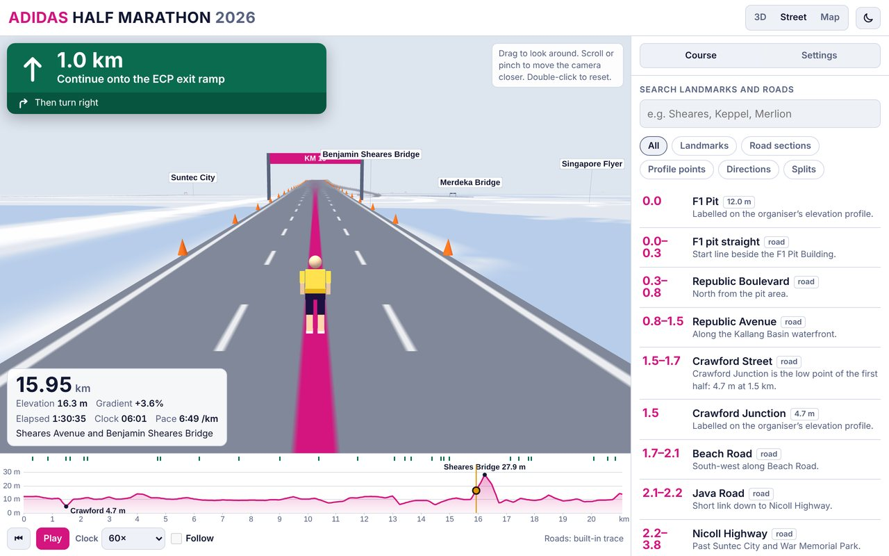
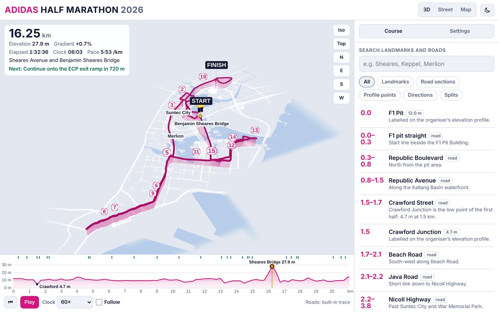

# marathon-route

An unofficial, interactive 3D model of the **adidas Half Marathon (21.0975 km)** at the **BYD Singapore International Marathon 2026**: F1 Pit Building to the National Stadium, Saturday 5 December 2026, flag-off 4:30 am. It includes a street-level runner view, turn-by-turn directions and a race-clock simulation for your target time. A matching Blender scene is included.



## Run it

`index.html` is the whole viewer in one file (three.js and Leaflet load from jsDelivr).

```sh
python3 -m http.server 8000      # then open http://localhost:8000/
```

Opening `index.html` straight from disk also works. The only exception is the Map view's street tiles: OpenStreetMap refuses tile requests from pages opened as `file://`. To publish it, turn on GitHub Pages for this repository (Settings → Pages → deploy from the `main` branch, root folder).

## What it does

| | |
|---|---|
| **3D overview** | Course over a street underlay, kilometre markers, landmarks, elevation curtain, adjustable vertical exaggeration, camera presets (Iso, Top, N/E/S/W). |
| **Street view** | Chase camera behind the runner at true scale. It shows the road with a race line and cones, a gantry at every kilometre, turn signs 30 m before each turn, and street lamps (decorative). Drag to look around, scroll or pinch to zoom. |
| **Buildings** | Real building footprints and heights, plus trees and parks, from OpenStreetMap within about 230 m of the course. They load the first time you open Street view, in seven pieces, and are kept in the browser (IndexedDB) for 30 days. Windows light up in the dark theme. |
| **Turn-by-turn** | Banner with the next instruction, distance and a "then" line. The **Directions** filter lists all instructions. |
| **Race clock** | The runner covers the course on your target time, in real time or at 10× to 300×. Pacing is *even pace* or *even effort* (slower uphill, faster downhill). Shows elapsed time, clock time from 4:30 am, current pace and **Splits**. |
| **Elevation profile** | Doubles as the timeline: drag to scrub. Turn ticks run along the top. |
| **Map view** | Leaflet 2D map with the route, kilometre markers and landmarks. Tiles come from OpenStreetMap (recoloured to the theme), CARTO light/dark (free key) or any provider URL. |
| **Road snapping** | On load it fetches roads from the OpenStreetMap Overpass API near the trace and snaps the course to them. If that fails it falls back to the built-in trace. |
| **Other** | Light and dark themes (both in Street view, where the dark one is the 4:30 am race), search, GPX/GeoJSON export, keyboard shortcuts. Settings are kept in `localStorage`. |



## Blender

`blender/sgim26_half_marathon_blender.py` builds the same course in Blender: street underlay, the route as a 3D curve, elevation curtain, kilometre markers, landmarks, and a runner that covers the course on `TARGET_TIME` with a chase camera. Open it in **Scripting → Open → Run Script**, or run `blender --python blender/sgim26_half_marathon_blender.py`. Settings such as `TARGET_TIME`, `PACING`, `VERTICAL_EXAGGERATION` and `USE_LIVE_OSM` are at the top of the file. `blender/sgim26_half_marathon.blend` is a ready-built scene.

It has been tested headless in Blender 5.3 only.

## Repository layout

```
index.html                 built viewer (generated, committed so it can be served as is)
src/
  core.js                  geometry, OSM fetch + snapping, pacing model, turn-by-turn (no DOM; unit tested in Node)
  app.js                   viewer: 3D scene, street view, map, chart, UI
  template.html            page markup and styles
data/
  data.json                route (lat/lon), elevation profile, road sections, landmarks
  basemap_cls.png          land / water / road mask for the 3D underlay (recoloured per theme)
  basemap_q.png            underlay used by the Blender script
  path_px.npy, elev_raw.json   intermediate outputs of scripts/trace.py
scripts/
  trace.py                 trace the route line and digitise the elevation profile from the official map
  georef.py, build_data.py map pixels -> lat/lon, clean the trace, write data/
  build_viewer.py          assemble index.html
  build_blender.py         assemble the standalone Blender script
blender/
  src/                     Blender script sources (header + settings, geometry core, scene)
  sgim26_half_marathon_blender.py, sgim26_half_marathon.blend
test/                      Node, browser (Playwright) and Blender tests
docs/                      screenshots
```

## Building

```sh
npm install                      # three, leaflet (inlined CSS), playwright for the browser tests
npm run build                    # index.html and the Blender script, from src/, blender/src/ and data/
```

To rebuild `data/` from scratch you need Python with `numpy`, `scipy`, `pillow` and `scikit-image`, plus the organiser's route map. The map isn't included in this repository. Save it as `reference/route-map.jpg`, or point `ROUTE_MAP` at it:

```sh
python3 scripts/trace.py         # -> data/path_px.npy, data/elev_raw.json
python3 scripts/build_data.py    # -> data/data.json, data/basemap_*.png
```

The tracing waypoints are pixel positions on the 2424 × 2023 version of the map, SHA-256 `202b9d35efdd9449ac2c0458b81a5df8f7b620a44c3b4e3cda79e4480608572e`, so a different export won't line up. With that file, both scripts reproduce the committed `data/` byte for byte.

## Tests

```sh
npm test                                         # core geometry, snapping, pacing, turn detection; Python/JS parity
CHROME_PATH=/path/to/chrome npm run test:browser # race clock timing, finish, splits, map tiles (headless Chrome)
python3 test/run_blender.py                      # needs the bpy module; checks runner positions, rebuilds the .blend
node test/shot.js blocked 1280 800 demo "street,km16" # screenshots into build/shots/
node test/shot.js city 390 780 city "street,wait3500,km2" # street view with the synthetic city
```

## Data and accuracy

This is an unofficial reconstruction. Check anything you rely on against the [official course page](https://singaporeinternationalmarathon.com/events/adidas-half-marathon/).

- **Route:** traced from the organiser's [route map](https://singaporeinternationalmarathon.com/wp-content/uploads/2026/10/SGIM-Half-M-Race-Route-Map-Elevation-Profile-1.jpg). The map is dated 17 August 2026 and says the route is subject to change. Positions come from fitting the map to landmark coordinates, so expect tens of metres of error until the OpenStreetMap snap succeeds.
- **Distance:** the traced line is 21.27 km against the certified 21.0975 km, and kilometre marks are spread in proportion. The Keppel Road U-turn lands at 7.60 km; the official profile puts it at 7.5 km.
- **Elevation:** digitised from the map's profile and pinned to its nine labelled points. Total gain is 65.4 m; the official figure is 68.3 m.
- **Turn-by-turn:** worked out from the traced line and the named road sections in `data/data.json`. Road names that the map doesn't label are marked as inferred. Ramps and complicated junctions (for example the ECP exit ramp around 17–18 km) are the least reliable.
- **Pacing:** *even effort* scales pace with the energy cost of running on a slope (Minetti et al., 2002, *J Appl Physiol* 93:1039) and counts only half of the downhill saving. That halving is an assumption. Heat, fatigue, crowding and drink stops aren't modelled.
- **Street view:** heights are true metres above the surrounding course, so bridges rise and roads sit on the map.
- **Buildings:** OpenStreetMap footprints. Height comes from the `height` tag, else `building:levels` × 3.2 m, else a default for the building type (an assumption). Settings shows the split for what loaded. Buildings the course line runs through are left out. That matters until the course is snapped to OpenStreetMap roads, because the built-in trace can be tens of metres off. Building parts replace their outline, which is how OSM models shaped towers. Roofs are flat.
- **Street lamps** along the course are decorative, not from map data.
- **Ground flicker:** the ground, map underlay and parks are drawn in a separate pass before everything else, so flat layers can't fight for depth.
- **Not yet tested against the live services:** the Overpass road and building fetches and the OpenStreetMap and CARTO tile requests have only been exercised against mocked responses (`test/synth_*.json`). The building test data is synthetic: rows of blocks along the real course, generated by `test/gen_features.py`.

## Credits

- Road, building, tree and park data and map tiles: © [OpenStreetMap](https://www.openstreetmap.org/copyright) contributors (ODbL) when fetched; optional [CARTO](https://carto.com/attributions) basemaps (key required).
- [three.js](https://threejs.org/) (MIT) and [Leaflet](https://leafletjs.com/) (BSD-2-Clause).
- Course, elevation profile and landmarks are derived from the organiser's published route map. This project is not affiliated with or endorsed by the BYD Singapore International Marathon or its organisers.

No licence has been chosen for this repository yet.
